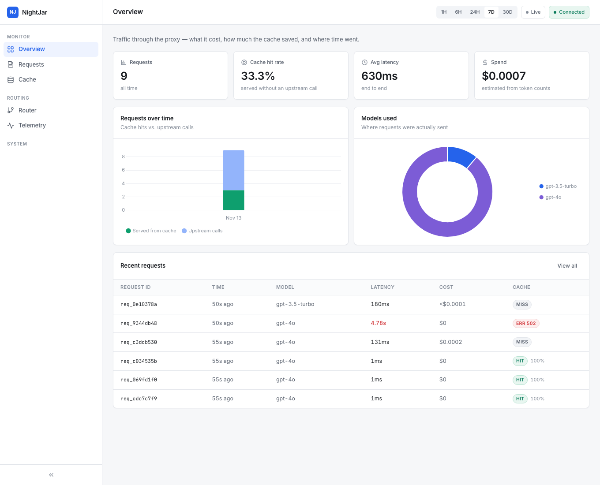

# NightJar

**A self-hosted, OpenAI-compatible gateway that sits in front of LLM providers and lowers cost and latency without returning wrong answers, and records what it did for every request.**

Point your client at `localhost:8000` instead of `api.openai.com`. NightJar adds an exact response cache (and an opt-in semantic one), optional cost routing, context compression, provider retries and limits, per-key access control and request telemetry, then forwards to whichever provider you configured through [LiteLLM](https://github.com/BerriAI/litellm).

[](https://github.com/Ayush-o1/NightJar/actions/workflows/ci.yml)


> NightJar was called ContextForge until November 2026. Old environment variable and header names still work and are deprecated; see [docs/operations/MIGRATION_2.0.md](docs/operations/MIGRATION_2.0.md).

---

## Why

An app that calls a provider directly pays full price and full latency for every request, including identical ones. A gateway is the one place where caching, routing and limits can apply to every service without touching their code, and where per-request records of cost and behaviour can be kept in one place.

The part that is easy to get wrong is the cache. A cached answer served to the wrong question is worse than no cache. So this project's design starts from correctness: the exact cache is always safe, and the semantic cache is opt-in, with its measured false-hit rate published next to it ([docs/benchmarks/CACHE_CORRECTNESS.md](docs/benchmarks/CACHE_CORRECTNESS.md)).

## What it does

| | |
|---|---|
| **Exact cache** (always on) | Same model, same parameters, same messages → stored answer, no provider call. Identical requests arriving together share one call. Only complete text answers are stored; tool calls, truncated answers, `n>1` and high-temperature requests are not. |
| **Semantic cache** (opt-in) | Near-duplicate prompts within the same model, parameters and conversation context, using local embeddings, a similarity threshold and lexical guards (numbers, negation, quotes, proper nouns). **It can still serve a wrong answer**: on the repo's labeled pairs, 3 of 41 should-not-match pairs got through with the guards on (a wide plausible range of roughly 2–20%). Leave it off if a wrong answer is expensive. |
| **Cost routing** (opt-in) | Classifies prompts as simple or complex and can switch to a cheaper tier. By default your requested model is honoured; routing happens for the model alias `nightjar/auto`, or `ROUTING_MODE=always`. What routing *would* have done is recorded either way. |
| **Context compression** | Summarizes old turns of long conversations on cache misses, never splitting a tool call from its replies; summaries are memoised. |
| **Reliability** | Explicit timeout, retries only for errors that can succeed, circuit-breaker cooldown, a cap on concurrent provider calls (503 + `Retry-After`), stream cancellation when the client disconnects. |
| **Access control** | Hashed API keys with `chat`/`admin` scopes, per-key model allow-lists and rate limits, secure-by-default in Docker. |
| **Telemetry** | One record per request: model, cache tier, tokens, estimated cost, latency, HTTP status, error code, key name. Dashboard at `/dashboard/`. |

What it deliberately is not: a provider-adapter library (LiteLLM does that), an eval or prompt-management platform, or a multi-replica SaaS. See [docs/research/LANDSCAPE.md](docs/research/LANDSCAPE.md).

## Quick start

### Docker

```bash
git clone https://github.com/Ayush-o1/NightJar.git && cd NightJar
cp .env.example .env
# edit .env: set a provider key (e.g. OPENAI_API_KEY) and NIGHTJAR_API_KEYS=<a key you choose>
docker compose up --build -d
curl http://localhost:8000/health
```

The image runs with `NIGHTJAR_AUTH=required`: with no key configured every request is refused (and the log says how to create one). Redis is not published to the host.

### Local

```bash
uv sync --frozen                                   # exact versions from uv.lock
cp .env.example .env                               # add a provider key
docker run -d -p 6379:6379 redis:7-alpine          # or any Redis
uv run uvicorn app.main:app --port 8000
```

With no keys configured a local install is open (convenient on localhost). Create scoped keys with `uv run python -m app.keys create --name app --scopes chat --rpm 60`.

### Use it

Change `base_url`; nothing else:

```python
from openai import OpenAI

client = OpenAI(base_url="http://localhost:8000/v1", api_key="your-nightjar-key")
reply = client.chat.completions.create(
    model="gpt-4o",                       # used as-is; "nightjar/auto" opts in to cost routing
    messages=[{"role": "user", "content": "What is the capital of France?"}],
)
```

Every response carries `X-Request-ID`, `X-Cache` (`HIT`/`MISS`/`BYPASS`), `X-Cache-Tier`, `X-Model-Selected`, `X-Model-Tier`. Request headers: `X-NightJar-Cache: bypass|refresh`, `X-NightJar-Model-Override`, `X-NightJar-No-Compress: true`. Errors use the OpenAI `{"error": {...}}` shape. Full reference: [docs/API.md](docs/API.md).

## How a request flows

```
POST /v1/chat/completions
  → limits + auth      body size, text budget, validation, key + scope + rate limit
  → route              keep the requested model, or pick a tier for "nightjar/auto"
  → cache              exact lookup → (opt-in) guarded semantic lookup → single-flight
  → on a miss          compress long chats → LiteLLM Router → provider → store
  → telemetry          one row when the response (or stream) finishes
```

Diagrams, the streaming path and every failure path: [docs/architecture/REQUEST_LIFECYCLE.md](docs/architecture/REQUEST_LIFECYCLE.md). Components and what limits scaling: [SYSTEM_DESIGN.md](docs/architecture/SYSTEM_DESIGN.md), [SCALABILITY.md](docs/architecture/SCALABILITY.md).

## Configuration

Every variable is documented in [`.env.example`](.env.example). The ones you will touch:

| Variable | Default | |
|---|---|---|
| `OPENAI_API_KEY`, `ANTHROPIC_API_KEY`, `GEMINI_API_KEY`, ... | none | Provider keys; set at least one |
| `NIGHTJAR_AUTH` | `auto` | `auto`: enforce once any key exists · `required`: always (Docker) · `off`: never |
| `NIGHTJAR_API_KEYS` | none | Comma-separated full-access keys. Prefer `python -m app.keys create` |
| `REDIS_URL` | `redis://localhost:6379` | Cached response payloads |
| `ROUTING_MODE` | `explicit` | `explicit` · `always` · `off` |
| `SEMANTIC_CACHE` | `false` | Opt-in semantic tier; `SIMILARITY_THRESHOLD` (0.92) applies only then |
| `CACHE_TTL_SECONDS` | `86400` | |
| `UPSTREAM_TIMEOUT_SECONDS` / `UPSTREAM_RETRIES` | `60` / `2` | |
| `MAX_CONCURRENT_UPSTREAM` | `128` | Beyond this: 503 + `Retry-After` |
| `MAX_REQUEST_BYTES` / `MAX_PROMPT_CHARS` | 8 MiB / 2,000,000 | 413 / 400 |
| `CORS_ALLOW_ORIGINS` | none | Browser origins allowed to call the gateway |
| `TELEMETRY_RETENTION_DAYS` | `0` | Delete telemetry older than N days at startup; 0 keeps everything |

## Testing

```bash
uv run ruff check app/ tests/ benchmarks/
PYTHONPATH=. uv run pytest tests/          # 460 tests; Redis is used if available (see below)
```

Cache tests run against a real Redis: `REDIS_TEST_URL` if set (CI uses a service container), otherwise a throwaway `redis-server` on a free port, otherwise they skip. Reliability tests run against a fake provider ([`benchmarks/fake_upstream.py`](benchmarks/fake_upstream.py)) over real HTTP through the real LiteLLM Router, so no test needs an API key or leaves the machine. Live provider tests (`tests/test_e2e.py`, marker `e2e`) are excluded by default and cost real money.

**Benchmarks** ([benchmarks/README.md](benchmarks/README.md)), all runnable without an API key:

```bash
uv run python benchmarks/gateway_bench.py --smoke     # ~10 s; needs redis-server on PATH
uv run python benchmarks/cache_eval.py                # semantic cache false-hit rate
```

Measured on an Apple M4 against a 50 ms fake provider (one run per scenario): the gateway adds about **14.5 ms** to a cache miss (0.7 ms of it NightJar's own code, 6.5 ms LiteLLM, about 7 ms not attributed), and an exact-cache hit costs about **0.5 ms**. Method and, importantly, limits: [docs/benchmarks/GATEWAY_OVERHEAD.md](docs/benchmarks/GATEWAY_OVERHEAD.md). Savings against a real provider have **not** been measured.

## Dashboard

`http://localhost:8000/dashboard/`: request log with HTTP status, cache hit rate and tier, model and routing distribution, latency and cost (estimated), cache stats. It shows only data from the API; with no backend it shows an "Offline" state. Plain HTML/CSS/JS with Chart.js, no build step. When auth is on, store a key once in the browser console: `localStorage.setItem('nightjar_api_key', '<admin key>')`.



*Nine requests to a local fake provider, including one deliberate provider failure (`ERR 502`). Not production data.*

## Project layout

```
app/            FastAPI service: pipeline, cache, router, proxy, auth, telemetry
app/static/     dashboard (HTML/CSS/JS)
config/         routing_rules.yaml
tests/          pytest suite (real Redis for cache tests, fake provider for reliability)
benchmarks/     gateway_bench, cache_eval, fake_upstream, labeled datasets
docs/           architecture/, research/, benchmarks/, operations/, API.md, DECISIONS.md, ROADMAP.md
```

## Documentation

| | |
|---|---|
| Understand the system | [LEARNING_GUIDE](docs/LEARNING_GUIDE.md) · [architecture/](docs/architecture/) · [DECISIONS (ADRs)](docs/DECISIONS.md) |
| Run it | [operations/DEPLOYMENT](docs/operations/DEPLOYMENT.md) · [TROUBLESHOOTING](docs/operations/TROUBLESHOOTING.md) · [MIGRATION_2.0](docs/operations/MIGRATION_2.0.md) |
| Why it is built this way | [BASELINE](docs/BASELINE.md) · [TECHNICAL_AUDIT](docs/TECHNICAL_AUDIT.md) · [research/](docs/research/) |
| Evidence | [CACHE_CORRECTNESS](docs/benchmarks/CACHE_CORRECTNESS.md) · [GATEWAY_OVERHEAD](docs/benchmarks/GATEWAY_OVERHEAD.md) |
| Status | [ROADMAP](docs/ROADMAP.md) · [IMPLEMENTATION_STATUS](docs/IMPLEMENTATION_STATUS.md) |
| Interviews | [INTERVIEW_PREPARATION](docs/INTERVIEW_PREPARATION.md) |

## Known limitations

Stated plainly; the long lists are in [IMPLEMENTATION_STATUS](docs/IMPLEMENTATION_STATUS.md), [FAILURE_HANDLING](docs/architecture/FAILURE_HANDLING.md) and [SECURITY_MODEL](docs/architecture/SECURITY_MODEL.md).

- **Single instance.** The vector index, SQLite files, single-flight table, cooldowns and rate limits are per process. Cached responses (Redis) are shared.
- **The semantic cache cannot be made fully safe** with embeddings plus lexical guards.
- **Nothing was tested against a real provider** (no credentials were available); behaviour is verified against a fake OpenAI-compatible server and LiteLLM's documented error mapping.
- **Cached responses are shared across callers** with identical requests (no per-key partition); use `X-NightJar-Cache: bypass` for per-user content.
- **No retry budget, no per-key spend limits**; fallback chains and default model names are still in code (some may be out of date).
- **Cost figures are estimates** from a short static price table; routing quality is not measured, only agreement with labels.

## Contributors

Originally a student team project: [Ayush Kumar](https://github.com/Ayush-o1), [Astik](https://github.com/Astik01), [Anubhav](https://github.com/Anubhav104401), [Aryan Bhat](https://github.com/aryanbhat2109-ctrl). The 2.0 modernization is documented in [ROADMAP](docs/ROADMAP.md).

## License

MIT, see [LICENSE](LICENSE).
