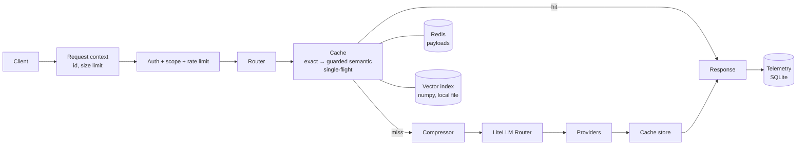

# Architecture

NightJar is one Python process (FastAPI under uvicorn) plus Redis. This page is an index; the detail lives in `docs/architecture/`.

| Read | For |
|---|---|
| [architecture/SYSTEM_DESIGN.md](architecture/SYSTEM_DESIGN.md) | Components, state, why a monolith |
| [architecture/REQUEST_LIFECYCLE.md](architecture/REQUEST_LIFECYCLE.md) | Request and streaming flows, every failure path |
| [architecture/DATABASE_DESIGN.md](architecture/DATABASE_DESIGN.md) | Tables, migrations, why SQLite |
| [architecture/SECURITY_MODEL.md](architecture/SECURITY_MODEL.md) | Threats, mitigations, gaps |
| [architecture/FAILURE_HANDLING.md](architecture/FAILURE_HANDLING.md) | What happens when each dependency or request misbehaves |
| [architecture/SCALABILITY.md](architecture/SCALABILITY.md) | What limits growth, upgrade order |
| [DECISIONS.md](DECISIONS.md) | ADRs (ADR-007 to ADR-009 cover the 2.0 changes; 001–006 are the original ones) |
| [LEARNING_GUIDE.md](LEARNING_GUIDE.md) | A guided tour for someone learning the system |

The pre-2.0 version of this file described FAISS, the adaptive threshold and the old pipeline order. It is in git history (`git show 1a4819c:docs/ARCHITECTURE.md`).
