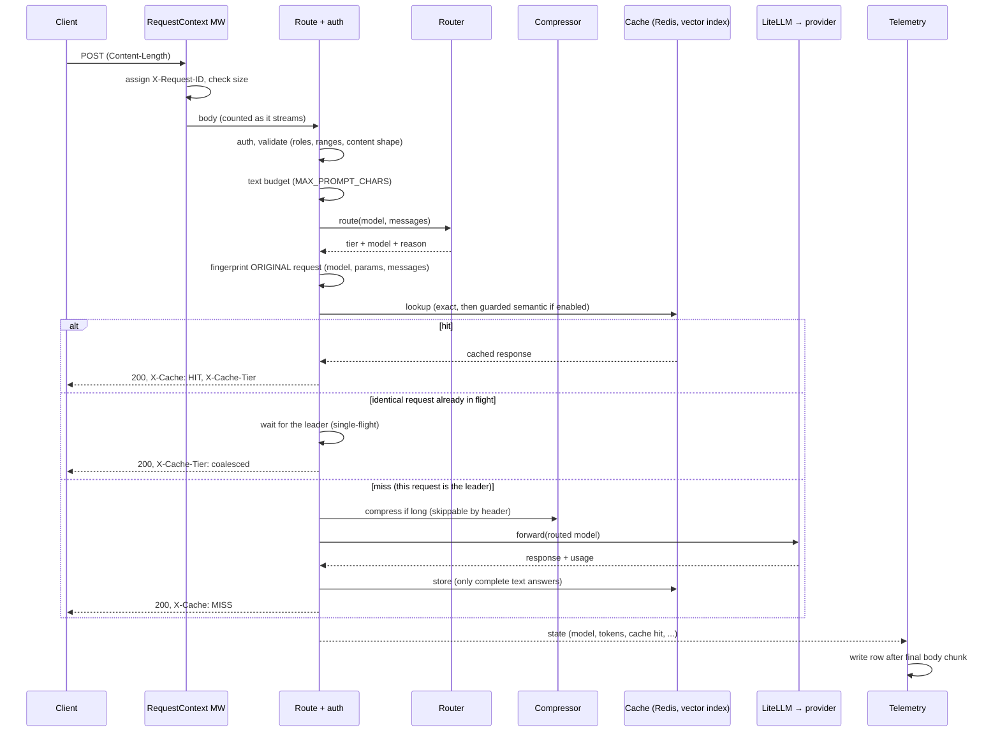
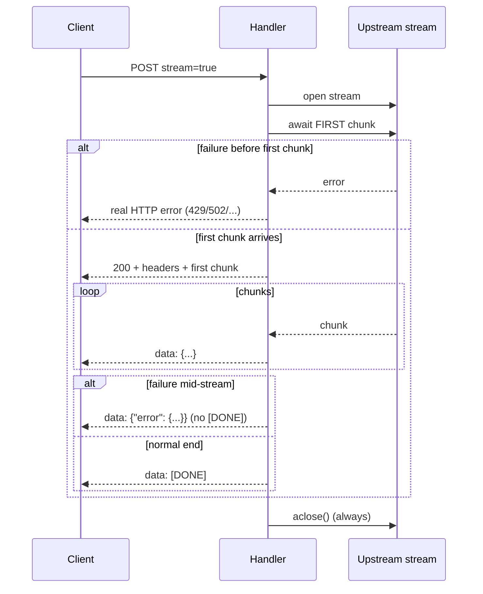

# Request lifecycle

`POST /v1/chat/completions`, as implemented after Phase 5. Failure paths come first because that is where gateways usually go wrong.

## Success path (non-streaming)

## Stages and what each can reject

| # | Stage | Rejects with | Notes |
|---|---|---|---|
| 1 | Body size (declared) | `413 request_too_large`, before reading | `Content-Length` over `MAX_REQUEST_BYTES` |
| 2 | Body size (counted) | `413`, mid-upload | For chunked bodies; the app's own reaction is discarded and replaced |
| 3 | Auth | `401 invalid_api_key` | Only when keys are configured (off by default today) |
| 4 | Validation | `400 invalid_request` / `invalid_json` | `param` names the field |
| 5 | Text budget | `400 context_length_exceeded` | Images/audio are not counted |
| 6 | Routing | none | Always succeeds; bounded token count |
| 7 | Cache lookup | none | Redis or embedder error degrades to a miss. Compression runs *after* this, on the miss path, so the key reflects what the caller sent |
| 8 | Compression | none | Any failure falls back to the uncompressed messages |
| 9 | Upstream call | `429`, `404`, `400`, `502`, `503`, `504` | Translated by `from_upstream` |

## Streaming

Awaiting the first chunk before building the response is the point: the HTTP status can still reflect a connect-time failure. Once the 200 is sent it can't change, so later failures use an in-band event. The telemetry row is written when the response ends, so its latency covers the whole stream. Token counts for streams are **not** recorded yet (zero); that arrives with `stream_options.include_usage` in Phase 8.

## Failure paths

| Failure | What the caller sees | What is logged |
|---|---|---|
| Redis down | Normal response, `X-Cache: MISS`, slower and paid. Redis calls time out after 1 s. | `cache.lookup.redis_error` |
| Embedding failure | Normal response, `X-Cache: MISS` (semantic tier skipped; exact tier unaffected) | `cache.lookup.embed_error` |
| Leader of a single-flight fails | Followers get the same error (not N retries). If the leader was cancelled, followers run on their own. | `upstream.error` |
| Compression summarizer fails | Normal response, uncompressed | `compressor.failed_graceful_fallback` |
| Provider rate limit | `429 rate_limit_error` | `upstream.error` (redacted) |
| Provider rejects NightJar's key | `502 upstream_auth_error` | `upstream.error` |
| Provider timeout / 5xx | `504` / `502` | `upstream.error` |
| Provider returns malformed data | `502` *(untested against a malformed fake upstream; Phase 7)* | |
| Client disconnects mid-stream | nothing | upstream stream closed in `finally`; *whether LiteLLM cancels the provider call is not yet verified (Phase 7)* |
| Telemetry write fails | Response unaffected | **silently swallowed today** (audit D-1, Phase 8) |
| Unhandled bug | `500` JSON containing the request ID | stack trace with request ID |

Rows marked *italic* are known gaps, listed here deliberately instead of implying coverage that doesn't exist.

## Identifiers

`X-Request-ID` (generated `req_…` or the caller's own, validated) is set on every response, stored as `telemetry.request_id`, and included in the text of 500 errors, so one value links the caller's report, the log line and the database row. `request_log` (written by LiteLLM's callback) still uses a different ID until Phase 8 merges the tables.
