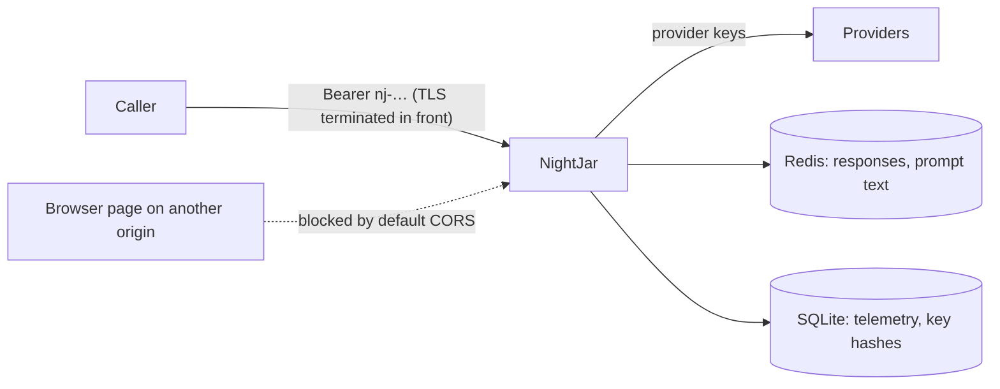

# Security model

What NightJar protects, from whom, how, and what it does **not** do. Status reflects the code in this branch; each claim marked *tested* has a test, and *checked* means I verified it by reading or running the code once.

## Assets and trust boundaries

| Asset | Where it lives | Who must not get it |
|---|---|---|
| Provider API keys (OpenAI, Anthropic, ...) | Environment / `.env`; copied into `os.environ` for LiteLLM | Callers, logs, error responses |
| NightJar API keys | Only a SHA-256 in SQLite (`api_keys`), shown once at creation; "env keys" in the environment | Anyone but the key holder |
| Prompts and responses | Request memory; **cached responses and the last user prompt text in Redis** (TTL); not in SQLite | Other callers, logs |
| Spend | The operator's provider account | Anyone able to call the gateway |

NightJar does not terminate TLS. Run it behind a reverse proxy or load balancer that does, or bind it to localhost.

## Threats and mitigations

| Threat | Mitigation | Status |
|---|---|---|
| **Anonymous use of an exposed gateway** (spend, data, cache flush) | `NIGHTJAR_AUTH`: `auto` enforces auth as soon as any key exists; `required` always (the Docker image sets it, so a container with no keys answers 401 and logs how to create one); `off` is an explicit opt-out. Local `uvicorn` with no keys stays open, which is a conscious convenience. | *tested*, and verified live |
| **Over-privileged keys** | Scopes `chat` and `admin`; chat keys get `403 insufficient_scope` on telemetry, cache and `/admin/*`. Env keys are full-access by design (the simple option). | *tested* |
| **Key leakage from storage** | Only SHA-256 of 256-bit random keys is stored. A fast unsalted hash is sound for high-entropy keys; it would not be for passwords. Key lists show a hint (`nj-rGB9…wLAE`), never the key. | *tested* |
| **Timing attacks on key comparison** | Env keys: `hmac.compare_digest`. Store keys: lookup by hash. | *checked* |
| **Revoked key still works** | Revocation is immediate in the process that did it and within **30 s** in others (lookup cache, `AUTH_CACHE_SECONDS`). | *tested*, verified across processes |
| **Spend abuse by an authenticated caller** | Per-key requests/minute (token bucket), optional per-key model allow-list plus gateway `ALLOWED_MODELS`, `X-NightJar-Model-Override` obeys both. Provider calls in flight are capped (503). | *tested* |
| **Resource exhaustion by one request** (OWASP LLM10 / "denial of wallet") | 8 MiB body limit before reading, text budget, bounded tokenization, concurrency cap. The baseline's 10 MB request froze the server for over 4 minutes; it now returns 413 in under 1 ms. | *tested*, verified live |
| **Caller attributing spend to someone else** | Attribution uses the authenticated key name (`request.state.api_key_name`), not the client-supplied `user` field. The telemetry column that persists it arrives in the telemetry phase; today `request_log.user_id` is still the client's `user`. | partial |
| **Cross-origin browser abuse** | CORS allows **no** origins by default (was `*`); set `CORS_ALLOW_ORIGINS` for browser apps. No cookies are used, so CSRF does not apply to bearer-token auth. | *tested*, verified live (preflight refused) |
| **Provider key or detail leaking into responses** | Server-side upstream errors use fixed messages; 400/404/429 messages include provider text truncated to 500 chars with key-shaped strings (`sk-…`, `Bearer …`, `AIza…`) redacted. A provider 401 is reported as 502 so the caller never sees it as an auth problem. | *tested* |
| **Prompts in logs** | No log event includes message content, prompts or bodies (checked by searching every `logger.*` call). Caveat: some events log `str(exc)` from library exceptions, which could in principle echo input. | *checked* |
| **Stored XSS via model names in the dashboard** | The dashboard escapes dynamic values; `model_used` can be attacker-influenced through the override header. | existing, not re-audited |
| **Malformed or hostile input** | Strict validation (roles, numeric ranges, content shape), OpenAI-shaped 400s, no exception detail in 500s. | *tested* |

## Cache and privacy

The response cache stores full responses in Redis, and the semantic tier also stores the user prompt text (needed to run the guards). Entries expire after `CACHE_TTL_SECONDS` (default 24 h) and carry no caller identity, **so a cached response is served to any caller whose request is identical, regardless of key**. That is correct for shared, non-personal prompts and wrong for per-user content. If your prompts contain personal or tenant-specific data, send `X-NightJar-Cache: bypass` for those calls, or run a separate NightJar (and Redis) per tenant. Per-key cache partitioning is not implemented.

Redis is not authenticated by default in the compose file; do not expose it. Put a password in `REDIS_URL` (`redis://:password@host:6379`).

## Not done / known gaps

- **No per-key spend limits** (needs reliable cost data; arrives, if at all, after the telemetry phase).
- **No tenant isolation in the cache** (above).
- **Rate limiting is per process** and in memory; N workers allow N times the limit.
- **No audit log** of key creation, revocation or admin calls beyond application logs.
- **No TLS, no mTLS, no IP allow-listing**: use the reverse proxy.
- **No secret scanning of prompts and no content moderation**: out of scope.
- **Key rotation** is create-new then revoke-old; there is no expiry date on keys.
- Admin endpoints return aggregate data only, but `/admin/logs` exposes `user_id`, which is client-supplied.
- The dashboard stores an optional bearer token in `localStorage` when auth is on; anyone with script access to that origin can read it.
