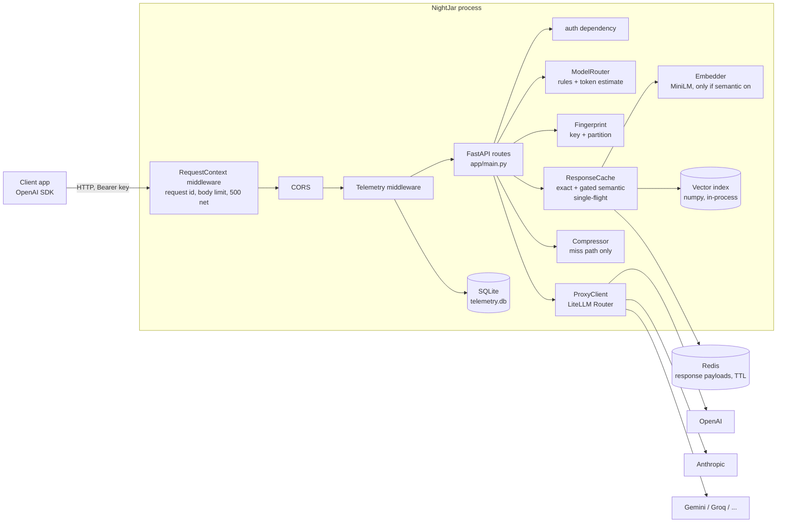

# System design

NightJar is one Python process (a modular monolith) plus Redis. This page describes what the code does **now**; planned changes are in [../ROADMAP.md](../ROADMAP.md) and the phase notes in [../IMPLEMENTATION_STATUS.md](../IMPLEMENTATION_STATUS.md). Last updated for Phase 5.

## Components

| Module | Responsibility | State |
|---|---|---|
| `app/asgi.py` | Request IDs, body-size limit, last-resort JSON 500 | none |
| `app/errors.py` | Error type, OpenAI-shaped bodies, provider-error translation, secret redaction | none |
| `app/main.py` | Routes, request pipeline, SSE handling, lifespan wiring | `app.state` holds the long-lived objects |
| `app/auth.py` | Bearer-token check (flat key list) | none |
| `app/models.py` | Request validation (roles, ranges, multimodal content) | none |
| `app/tokens.py` | Message-text extraction; bounded token counting | encoder cache |
| `app/router.py` | Complexity classification, tier → model | YAML rules loaded at start |
| `app/compressor.py` | Summarizes old turns past a token threshold | none |
| `app/fingerprint.py` | Canonical request fingerprint (exact key + partition), cache eligibility | none |
| `app/cache.py` | Exact tier, guarded semantic tier, single-flight, admin ops, background snapshot | Redis + vector index |
| `app/guards.py` | Lexical checks that veto semantic hits (numbers, negation, quotes, proper nouns) | none |
| `app/vector_index.py` | Partition-scoped brute-force cosine search, TTL, size cap, atomic snapshot | `data/vectors.npz` |
| `app/embedder.py` | MiniLM embeddings; loaded only when `SEMANTIC_CACHE=true` | model in memory |
| `app/proxy.py` | Provider calls via LiteLLM Router, retries/fallbacks | Router in memory |
| `app/telemetry.py`, `middleware.py` | Per-request rows | SQLite |

## Why a monolith

Everything on the hot path is either an in-process call (router, tokens, FAISS) or a network call that would exist anyway (Redis, providers). Splitting the router, cache or embedder into services would put a network hop in front of the thing whose job is to save time, and the audit found no problem that a process boundary would fix. The first measured reason to split would be embedding saturating a core; the design keeps embedding behind `asyncio.to_thread` so it can move to a worker pool and then to a separate process if [Phase 11](../ROADMAP.md) shows that.

## State and what limits scaling out

| State | Where | Shared across replicas? |
|---|---|---|
| Response payloads | Redis | Yes |
| Vectors | `data/vectors.npz` on local disk (semantic tier only) | **No** |
| In-flight request table (single-flight) | In memory | **No** |
| Telemetry | SQLite file on local disk | **No** |
| LiteLLM cooldown/failure counters | In memory | **No** |

So today a second replica has its own cache index and its own telemetry. Details and upgrade paths: [SCALABILITY.md](SCALABILITY.md) (written in Phase 11/13 with measurements).

## Process-level concurrency

One uvicorn worker, one event loop. Handlers are `async`; CPU-bound or blocking calls are pushed to threads (`asyncio.to_thread`): embedding and the telemetry write. The vector search itself runs on the loop (sub-millisecond at the sizes it is capped to, measured in ADR-009). Not yet off the loop: the other SQLite calls (audit D-1). Token counting is bounded instead of offloaded (see [../research/TECHNICAL_FINDINGS.md](../research/TECHNICAL_FINDINGS.md) F4).
